# pico-thing

A Raspberry Pi Pico W with a Waveshare Pico-ResTouch-LCD-3.5 touchscreen, running a
little terminal-style OS on my desk. It's written in Rust with
[ratatui](https://ratatui.rs) and [Embassy](https://embassy.dev).

It shows clock, weather and other faces, runs a Pomodoro timer, and controls my
Yeelight lamps and Sonos speakers over the local network. A small server on my Mac
(`companion/`) tells it what Claude Code is doing and how the Mac is holding up.

<table>
  <tr>
    <td>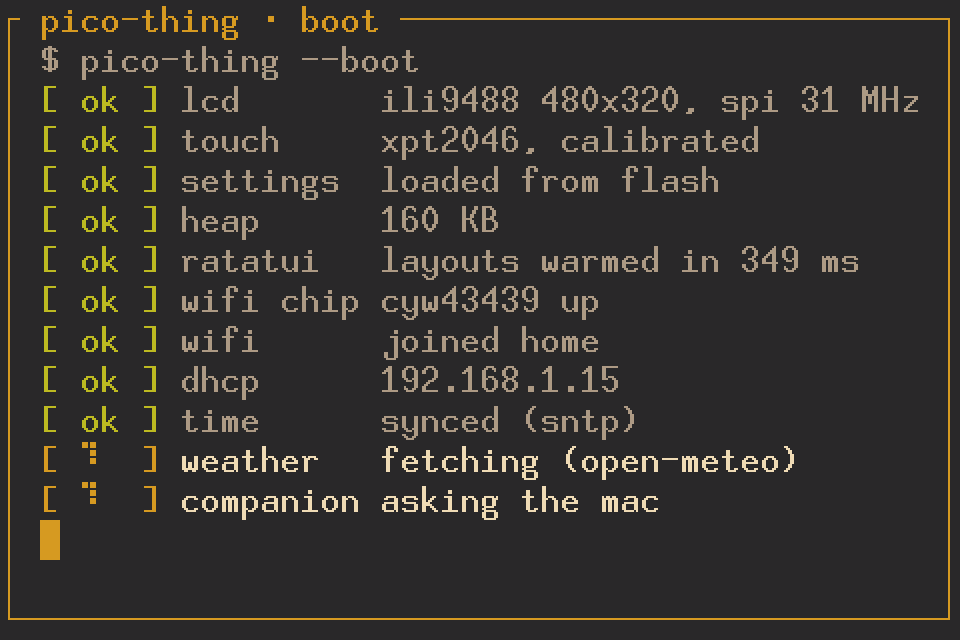</td>
    <td>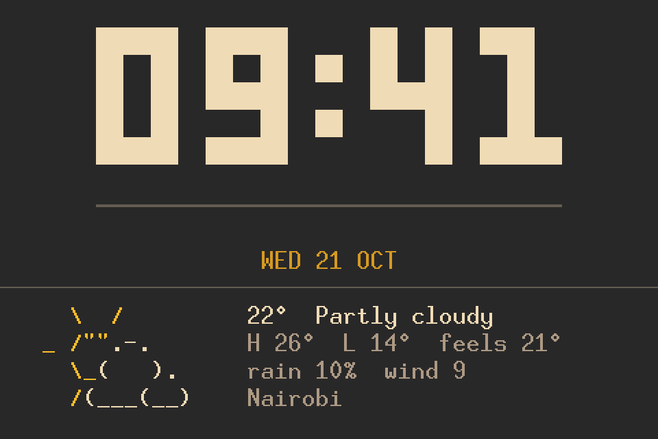</td>
    <td>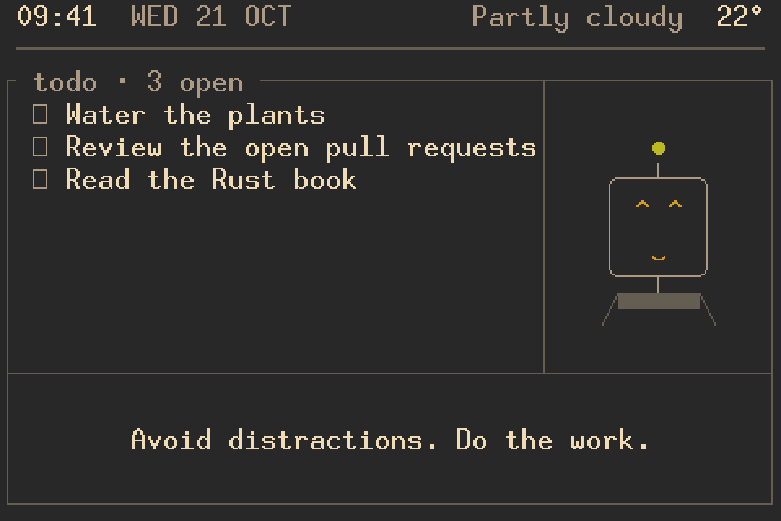</td>
  </tr>
  <tr>
    <td>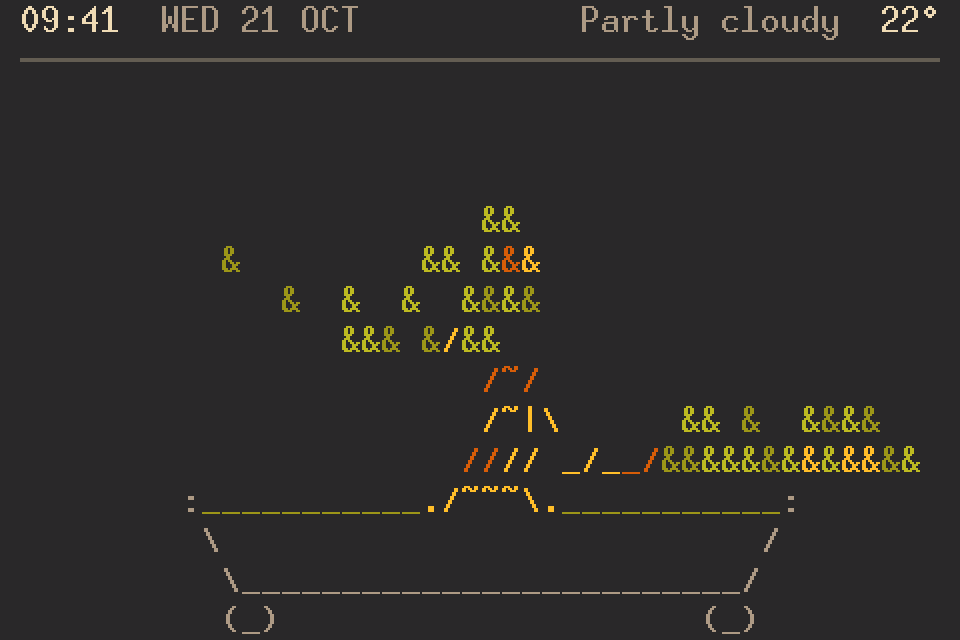</td>
    <td>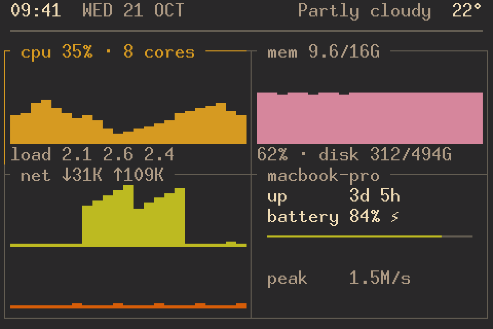</td>
    <td>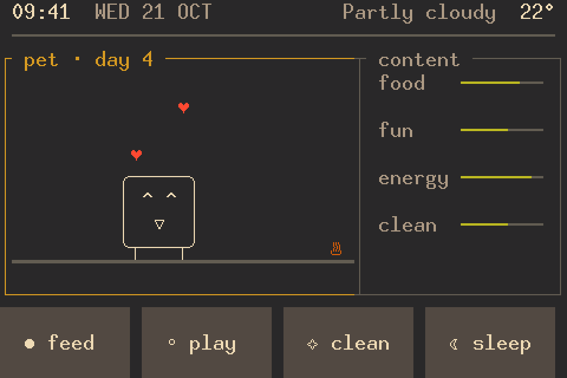</td>
  </tr>
  <tr>
    <td>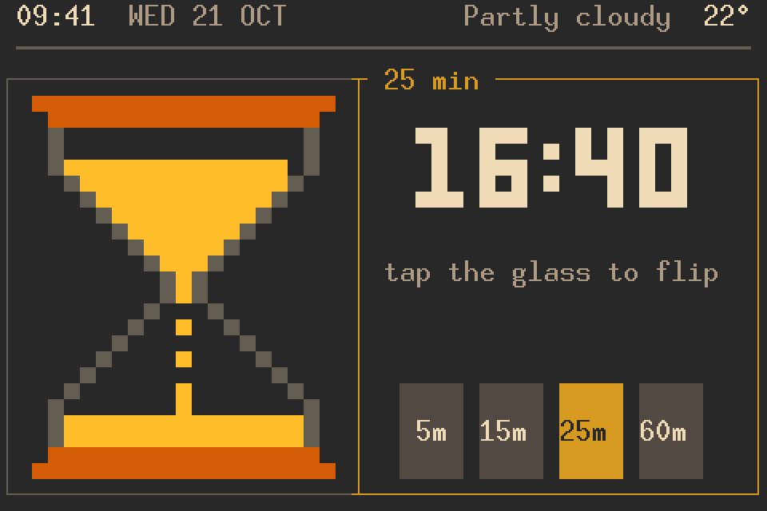</td>
    <td>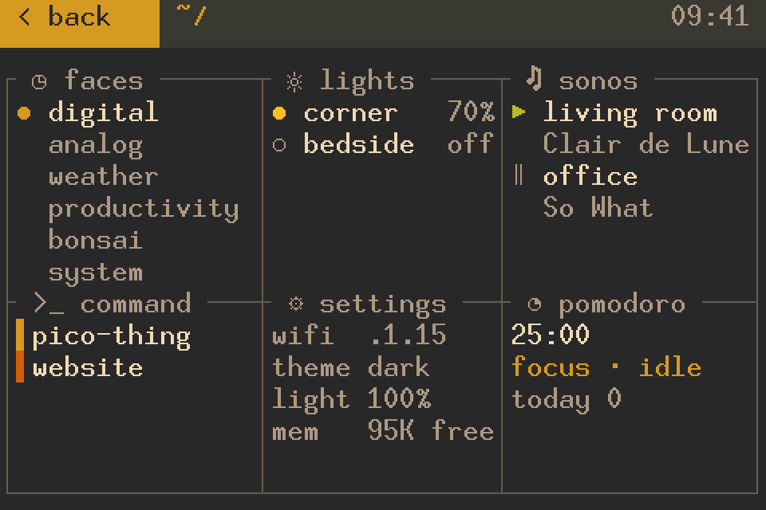</td>
    <td>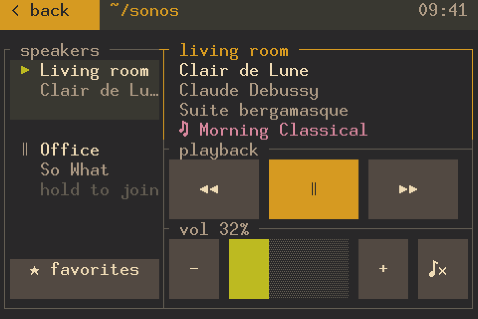</td>
  </tr>
  <tr>
    <td>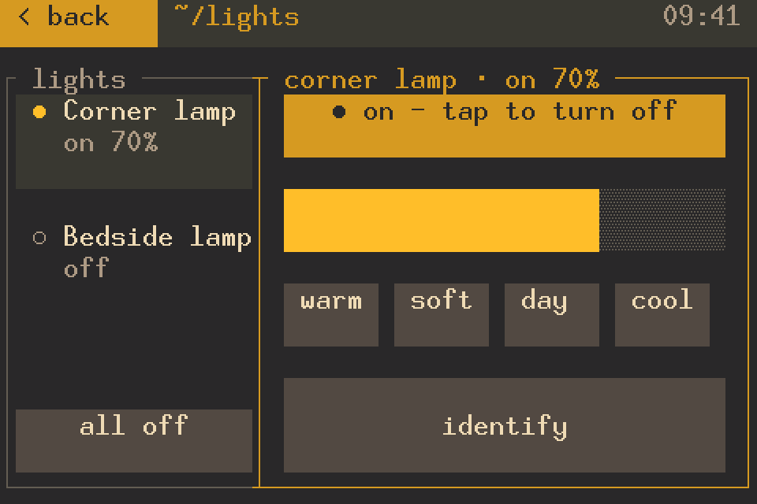</td>
    <td>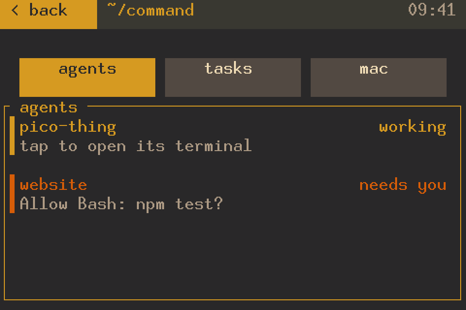</td>
    <td>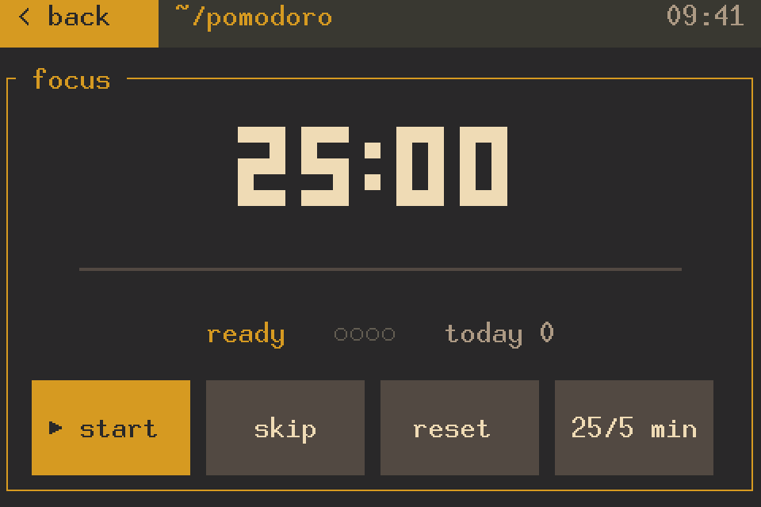</td>
  </tr>
</table>

The rest are in `docs/screenshots`. They come from `cargo run --example screenshots`
in `sim/`, which draws each screen with the firmware's font and colours, so they
match the panel pixel for pixel.

## Layout

```
core/        the app: screens, faces, touch targets, network protocols (no_std)
firmware/    the Pico: panel and touch driver, Wi-Fi, flash storage, USB serial
sim/         the same app in your terminal, plus the screenshot and dump examples
patches/     ratatui-widgets with Arc swapped for Rc (the RP2040 has no atomics)
companion/   Mac server, Claude Code hook and the pico-thing CLI (Python)
docs/        screenshots
```

`core` never touches hardware. The firmware and the simulator feed it events (taps,
time, network results) and carry out what it asks for, so every screen and protocol
is written once. The screen is a 48x16 grid of 10x20 pixel cells.

## Setup

1. `cp config.example.toml config.toml` and fill in your Wi-Fi, lights, speakers and
   companion token. `config.toml` is gitignored; it's read at build time.
2. `./flash.sh` builds the firmware and flashes the Pico. The first time, hold
   BOOTSEL while plugging the Pico in. After that the script reboots it into the
   bootloader over USB serial.
3. On the Mac, run `python3 companion/server.py`, or install it as a LaunchAgent and
   manage it with `companion/pico-thing`.

## Working on it

```sh
cd sim && cargo run                          # the app in your terminal; click to tap, q quits
cd sim && cargo run -- --check               # run every network job once against the real devices
cd sim && cargo run --example dump sonos     # print screens as text
cd sim && cargo run --example screenshots    # redraw docs/screenshots
cd core && cargo test
```

The Pico logs to USB serial (`/dev/cu.usbmodem*`) and takes two commands there: `b`
reboots into the bootloader and `t COL ROW` taps a cell. After a panic it restarts
and prints the message on the next boot.

Ideas and unfinished work are in `TODO.md`.
